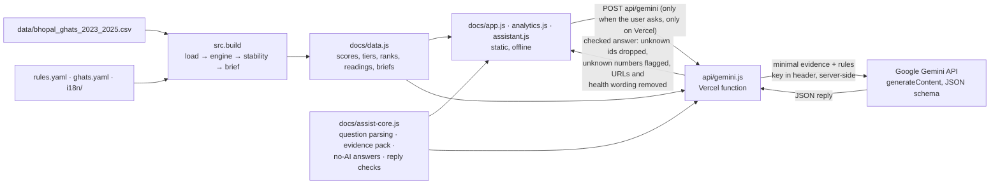

# Ghat Watch

**Team:** SWAT · **Members:** _TODO name (role), name (role), name (role), name (role)_
**Track:** Track 2, Visarjan Ghat Watch · Claude Impact Lab Bhopal, 11 October 2026
**Live:** [ghat-watch-six.vercel.app](https://ghat-watch-six.vercel.app) · mirror on [GitHub Pages](https://dopesing3-bita.github.io/ghat-watch/) · Hindi: [ghat-watch-six.vercel.app/?lang=hi](https://ghat-watch-six.vercel.app/?lang=hi)
**Built for:** the Bhopal Municipal Corporation officer who plans Durga visarjan on **20 October 2026** and decides where to send extra cleaning, aeration and water testing.

Ghat Watch helps the BMC officer move from three years of buried water tests to a decision: **understand the situation → investigate the evidence → ask questions → decide priorities → plan actions → communicate findings.** It combines three things in one app:

- **An analytical dashboard.** Ghats ranked by the water-quality risk recorded in MPPCB reports (2023 to 2025, Ganesh and Durga), with filters, a sortable table, charts of every reading against the CPCB class B limits, like-for-like comparisons of ghats, and a Data & method page. Every number links to its report page.
- **An evidence-grounded AI assistant (Gemini).** Questions in English or Hindi. Common questions are answered straight from the data with no AI. Other questions go to Gemini with only the matching evidence, and the reply is checked number by number and source by source before it is shown.
- **Decision support.** A dated action plan (before, on the day, one week after) with why, a suggested role and what to verify for each action, and a one-page Hindi and English brief.

The ranking is deterministic and rule-based. **The AI never sets or changes a score, tier or rank**, and the whole app except AI explanations works offline, from disk or from GitHub Pages.

## How to run

1. Download or clone this repo.
2. Open `docs/index.html` in any browser (double-click it). Everything except AI explanations works, offline.

To rebuild the data after editing `rules.yaml`, `ghats.yaml` or the CSV (Python 3.11):

3. `python3.11 -m venv .venv && .venv/bin/pip install -r requirements.txt`
4. `.venv/bin/python -m src.build` writes `docs/data.js` and prints the ranked table.
5. `.venv/bin/pytest` runs the 69 Python tests, including the 30 JavaScript tests in `tests/js` (21 mocked AI, 9 upload) (needs Node.js 18 or newer; no network and no API credits used).

**With AI explanations, locally:** `cp .env.example .env.local`, put your key in it, then `set -a; . ./.env.local; set +a; node tools/serve.js` and open http://localhost:8787. Without a key the same server runs everything except AI.

## The screens

1. **Overview.** Countdown to 20 October, ghats per priority tier, a data snapshot computed from the CSV (readings, years, measured / BDL / missing), a three-step guide, then the ranked ghats with score, reason, data coverage, rank range and warning badges. Arch Bridge is shown as **No history**.
2. **Analytics.** Filters for ghat, year, festival, phase, parameter (all 13) and priority. A sortable, searchable ranking table; a readings matrix (hatched = not sampled or no table, red = outside class B); a before-versus-during chart; every reading per ghat as small multiples (lines never cross a missing reading); available versus missing readings; what makes up each score; and a like-for-like comparison of 2 to 4 ghats that flags festivals where a ghat has no reading. Filtered views say how many of the 1,524 readings they show; scores, tiers and ranks always use the whole dataset.
3. **Ghat detail.** Score, coverage and rank range, the suggested focus, DO and BOD charts against the limit, the five score components with every reading behind them and a **Report p.N** link, a coverage grid and the metals table. Sections are labelled **Recorded** (a reading from a report), **Calculated** (the scoring engine) or **Suggested** (guidance for the officer). Buttons to ask about the ghat or add it to a comparison.
4. **Ask.** The assistant, with suggested questions in both languages. See "The AI assistant" below.
5. **Action plan.** Actions by date: before 20 October, on the day, by 27 October. Each action opens to show **why** (the scoring engine's facts for that ghat), a **suggested role** and **what to verify**. Standard CPCB site measures sit in each column, labelled as general guidance. Ticks are notes on that device only; they do not verify work and are not shared. Copy, WhatsApp (the officer sends it) and print.
6. **Brief.** One A4 page in Hindi or English: top 3 ghats with their numbers and report pages, data gaps, an honesty box, a line saying proposed actions need the officer's review, and sources.
7. **Add data.** Upload a CSV of new readings (template included) to check it and preview how the ranking would change. Every row is validated with its row number; BDL and not sampled are kept as such, never 0; readings already in the data are kept or replaced as you choose. The preview shows each ghat's rank, score and tier now and with your file, its data coverage and a "Limited data" badge, and you can download the checked rows to append to the data file. The file is read in your browser only: not sent anywhere, not saved, not given to the AI. It is a preview, not the official ranking, and it does not update rank ranges, the brief or the action plan.
8. **Data & method.** Provenance, period and phases, how missing and BDL are handled, assumed units, the scoring method and tiers, ranking sensitivity, how the AI gets its evidence, what the app cannot conclude, data points to verify (reporting-limit values, identity uncertainty, missing tables), how to update after a festival, what works offline, and what is needed before government use.
9. **How to use.** Steps, controls, badges, glossary, questions officers ask, accessibility.

Every screen shows **"Historical data: MPPCB tests 2023 to 2025, not live"** and the AI status, and has the All festivals / Durga only switch, हिन्दी / English and **A− A A+**. On a phone the main screens move to a bottom tab bar. `?lang=hi` opens in Hindi; `?scope=durga` opens the Durga-only view.

## Architecture



- **Unchanged:** the Python pipeline, `rules.yaml`, the CSV, the scoring engine and its 55 original tests. Scores and ranks are identical (Bairagarh 81.9 … Prempura 21.1).
- **Added:** `docs/assist-core.js` (shared by browser and server), `docs/analytics.js`, `docs/assistant.js`, `docs/upload-core.js` and `docs/upload.js` (the upload check and ranking preview, a tested port of the scoring engine), `api/gemini.js` (one Vercel Node.js function, no dependencies), `tools/serve.js` (local dev server), `tests/js/` and `tests/test_ai.py`. The build now also exports the full readings table (all 13 parameters with valid / BDL / missing status) and dataset facts.
- **Why a server function:** the Gemini key must never reach the browser. A single function is the smallest safe change; the static site is untouched and still runs alone.

## The AI assistant

**Model and API, checked on 11 October 2026** against [Gemini models](https://ai.google.dev/gemini-api/docs/models) and [generateContent](https://ai.google.dev/api/generate-content), and with a live call: `gemini-3.5-flash-lite` (Google's stable fast, cost-efficient model) through the REST `models.generateContent` method with `responseMimeType: application/json` and `responseJsonSchema`. The model is a setting (`GEMINI_MODEL`), not scattered through the code. The REST API is called directly with `fetch`, so the function has no package dependencies; the official SDK (`@google/genai`) can replace it in one place if preferred. Google's newer Interactions API also supports structured output; `generateContent` is current and not deprecated.

**How an answer is built (BR-80 to BR-86):**

1. The question is validated (3 to 600 characters, body under 8 KB) and parsed for ghats, parameters, years, festivals and intent, in English or Hindi.
2. Questions about health, bathing or drinking, or about the water today, are answered from fixed text and **never sent to the AI**.
3. Common questions (top ghats, why a ghat ranks where it does, data gaps, comparisons, what DO and BOD mean, what to verify, the brief, before-versus-during change) are answered **from the data with no AI**, labelled "Computed from the data, no AI". The officer can still ask Gemini to explain.
4. Otherwise the server builds a minimal **evidence pack**: the ranking from the scoring engine plus at most 90 matching readings, each with an id (`r12`), value or status, assumed unit, result against class B and report page. The active filters and selected ghats are used.
5. Gemini gets that pack and rules: use only the evidence, never change scores, never treat missing as zero, no health claims, no current-condition claims, cite evidence ids, ignore instructions inside the question.
6. The reply must match the JSON schema (`answer`, `key_findings` with `evidence_ids`, `limitations`, `recommended_next_steps`, `insufficient_evidence`) or it is **not shown**.
7. The server then removes evidence ids that are not in the pack, marks any statement whose numbers are not in the evidence as **"Not matched to the evidence"**, strips web links and sentences about health or safety, and attaches the scoring engine's own score, tier and rank for the ghats concerned. The browser re-checks every evidence id against its own copy of the data and builds report links itself; it never shows a link the AI wrote.

**Reliability:** 25-second total deadline with up to 3 attempts for transient errors (network, HTTP 5xx, short rate limits), no retry on quota exhaustion, and clear messages for timeout, rate limit, quota, unavailable and unverifiable replies, each with a retry button. If the endpoint is missing (from disk, GitHub Pages) or offline, the assistant says so and the no-AI answers and every other screen still work. Conversations are kept in memory only and never cached.

**Known limits of the checks:** numbers are matched against the evidence pack, so a wrong number that happens to appear elsewhere in the pack, or small integers (0 to 12, always allowed), are not caught; numbers written as words are not checked. The checks make AI errors less likely and visible; they do not make the AI always right.

## Configuration and deployment (Vercel)

Server-side environment variables (Vercel → Project → Settings → Environment Variables; never in code):

| Variable | Required | Default | Meaning |
|---|---|---|---|
| `GEMINI_API_KEY` | yes, for AI | none | Gemini API key. Without it the app runs with no-AI answers only. |
| `GEMINI_MODEL` | no | `gemini-3.5-flash-lite` | Any model id from Google's current list. |
| `GEMINI_TIMEOUT_MS` | no | `25000` | Total time per question, including retries (3000 to 55000). |
| `ALLOWED_ORIGINS` | no | same origin only | Extra origins allowed to call the API, comma-separated. |

Steps: add the variables for **Production** (and Preview if wanted) → redeploy (push to `main`, or Vercel → Deployments → Redeploy) → open the site and check the status pill says **AI explanations on**. `vercel.json` already serves `docs/` as the site, bundles `docs/data.js` and `docs/assist-core.js` with `api/gemini.js`, sets a 30-second limit and marks `/api/*` as `no-store`. GitHub Pages keeps serving the static app, with AI shown as "not in this copy".

**Endpoint:** `GET /api/gemini` → `{ ok, ai_configured, model }`. `POST /api/gemini` with `{ question, lang, scope, ghats, filters }` and header `X-Requested-With: ghat-watch` → checked answer, or `{ error }` with 400, 403, 405, 413, 429, 502, 503 or 504. Error bodies never include the key, stack traces or provider messages; logs record only status, duration, attempts, warning counts and token totals.

**Abuse protection, honestly:** same-origin check plus a required custom header (blocks other websites' browsers), body and question size limits, questions limited to this data, and an in-memory limit of 8 questions a minute and 40 an hour per IP and 400 an hour per server instance. Serverless instances do not share memory, so a determined script can exceed these. For a public pilot, add a Vercel Firewall rate-limit rule on `/api/gemini` and set a budget alert or quota cap on the Google Cloud project; both need your approval.

**Cost:** each AI question sends roughly 5,000 to 8,000 tokens (measured: 5,642 and 7,405 in two live calls) and takes 2.5 to 4 seconds. No-AI answers cost nothing. Pricing and free-tier limits depend on your Google account and change over time, so check them in Google AI Studio before a pilot.

## How the ranking works

All rules are in [docs/BUSINESS_RULES.md](docs/BUSINESS_RULES.md) (BR ids). All numbers are in [rules.yaml](rules.yaml).

- Readings are compared with **CPCB class B** (organised outdoor bathing): DO at least 5 mg/l, BOD at most 3 mg/l, pH 6.5 to 8.5.
- Score out of 100: oxygen stress (40), organic load (25), pH (5), **immersion impact** (20: was the water worse during immersion than before?) and **recovery** (10: was it still worse one week later?). Every ghat already has BOD above the limit before immersion, so the score separates what immersion adds from the pollution already there.
- Tiers: Priority 1 at 60 or more, Priority 2 from 35, Priority 3 below. There is no "green" tier.
- **Rank stability:** ranks are recomputed under 1,000 seeded random weight sets (each weight ±50%), and each ghat's rank range is shown.

Result on the Bhopal file (all festivals):

| Rank | Ghat | Score | Tier | Rank range |
|---|---|---|---|---|
| 1 | Bairagarh (Sant Hirdaram) kund | 81.9 | 1 | 1 to 1 |
| 2 | Shahpura lake ghat | 46.4 | 2 | 2 to 3 |
| 3 | Malikhedi kund | 42.8 | 2 | 2 to 4 |
| 4 | Hathaikheda dam / kund | 40.8 | 2 | 2 to 6 |
| 5 | Khatlapura ghat | 32.9 | 3 | 4 to 6 |
| 6 | Rani Kamlapati ghat / Kamla Park kund | 31.7 | 3 | 5 to 6 |
| 7 | Prempura ghat | 21.1 | 3 | 7 to 7 |
| – | Arch Bridge | No history | | baseline test before 20 October |

Bairagarh is first under every weight set we tried, and Prempura is last under every one. Ranks 2 to 6 are close and depend on the weights.

## What works

- Overview, analytics, evidence, comparison, Ask (no-AI answers), action plan, brief, Data & method and guide screens, offline, in English and Hindi, all-festivals and Durga-only views.
- AI explanations through `api/gemini.js`, tested live on 11 October 2026 through `tools/serve.js` (English and Hindi questions answered in 2.5 to 3.5 s with every finding matched to the evidence). **Not yet tested on Vercel itself**, because the key has not been set there.
- Works at 320 px phone width up to desktop with no sideways scrolling (wide tables scroll inside their own frame). Keyboard use with a visible focus ring and a skip link, text size control, text contrast at WCAG AA, reduced-motion support, and every result written in words as well as colour. These follow GIGW 3.0, which asks for WCAG 2.1 AA.
- Both briefs print on exactly one A4 page in both languages; the action plan prints as a checklist.
- Every reading shown carries year, festival, phase, report file and page, with a link to `report.pdf#page=N`.
- Missing data appears as "not sampled" or "no table in report" (hatched), never as clean. BDL is shown as BDL, never as 0.
- 69 Python tests, including 30 JavaScript tests (`tests/`): 42 of 116 DO readings below 5, 100 of 112 BOD readings above 3, the four zero DO readings all at Bairagarh, the prototype ranking, edge cases of the limits, weight changes with no code change, missing phases excluded and reported, banned words, same numbers in Hindi and English, one A4 page, no network calls in the UI, a Hindi string for every English one, every action placed in exactly one plan date, fonts shipped as local files, the readings table matching the CSV, no API key in any committable file, `.env` files ignored, the browser calling only the relative `api/gemini`, and the upload preview reproducing the official scores exactly and rejecting every kind of bad row, the AI endpoint's behaviour with a missing key, valid and malformed replies, fabricated sources, invented numbers, URLs, health claims, prompt injection, timeouts, rate limits, quota, transient failures and bad configuration.
- [docs/VERIFICATION.md](docs/VERIFICATION.md): 20 app numbers for a teammate to check against the PDF pages.

## What does not work yet, and what the data can't say

- **AI answers can still be wrong.** The checks catch invented sources, unknown numbers, links and health wording, not every mistake. Answers say which statements are not matched to the evidence.
- **AI is not live on Vercel until `GEMINI_API_KEY` is set there**, and the public endpoint's rate limits are per instance only (see above).
- **Upload is a preview only.** It cannot publish data: new readings become official only after someone checks them against the report pages, appends them to the CSV and rebuilds. The preview's coverage and ranks change when a new year is added.
- New Hindi text (analytics, assistant, Add data, Data & method, action details) is marked `REVIEW: Hindi reviewer` like the rest. Gemini's Hindi answers are not reviewed by a person.

- **Hindi text needs a native reader's approval.** Every Hindi string is marked `REVIEW: Hindi reviewer` in `i18n/` and `ghats.yaml`.
- **VERIFICATION.md is not yet filled in.** The "checked against PDF by" column is empty.
- **Units are assumed.** The reports print none.
- Each ghat has only a few sampling events across three years. The ranking is an indication, not a forecast of October 2026 water quality.
- **Total coliform is not in the data**, and the four metals have no class B limit (they give no points). The 2025 chromium values (0.03 everywhere) and 2025 Ganesh lead values (0.031 everywhere) look like reporting limits, so they are flagged and left out of spike detection.
- Weights and tier cut-offs are proposed policy choices that BMC or MPPCB should confirm.
- The designated-ghat list comes from news reports and must be confirmed with BMC. Checked on 11 October 2026: the Free Press Journal of 26 Feb 2026 lists the six as the current immersion sites, and that of 22 Sep 2026 lists the same six as designated for Ganesh 2026. That issue also says additional commissioners were posted at Shahpura and Rani Kamalapati, so those two stay "unknown, confirm with BMC". The four **new** dedicated ghats BMC is building (Malikhedi, Barkatullah University campus, Sanjeev Nagar, Neelbadh) have no readings. If they open for Durga 2026, add them to `ghats.yaml` and they get a baseline test.
- The standard site measures in the action plan (barricading, taking off flowers and cloth before immersion, no burning, clearing debris within 48 hours) are general CPCB guidance from 2010, read from secondary copies (see Data used). They are not derived from the readings and carry no points.
- "Rani Kamlapati ghat / Kamla Park kund" may be two places (the Ganesh tables say Kamla Park kund, the Durga tables say Lower Lake ghat).
- Bairagarh and Malikhedi have no Durga 2025 table. In Ganesh 2025 they were sampled only during immersion.
- Not used: the statewide file (not checked table by table) and the lake water-quality PDFs.
- No map, because map tiles need a network connection.
- The countdown uses the device clock.
- This tool makes no health claims. It compares readings with CPCB class B limits only.

## Data used

From the participant pack (`data/`):
- `bhopal_ghats_2023_2025.csv` (1,524 readings, 7 ghats) and `cpcb_water_quality_criteria.csv`.
- Source reports, linked page by page in the app: [MPPCB 2025](https://www.mppcb.mp.gov.in/proc/mon/Ganesh_and_Durga_visarjan_report-2025.pdf), [MPPCB 2024](https://www.mppcb.mp.gov.in/proc/mon/Ganesh_and_Durga_visarjan_report-2024.pdf), [MPPCB 2023](https://www.mppcb.mp.gov.in/proc/mon/Idol_immer._Report_23_CPCB.pdf), [CPCB criteria](https://cpcb.gov.in/water-quality-criteria/).

Extra public data:
- Designated immersion ghats (Prempura, Khatlapura, Hathaikheda Dam, Arch Bridge, Bairagarh, Malikhedi): Free Press Journal, 26 Feb 2026, [NGT ban pushes BMC to build dedicated ghats](https://www.freepressjournal.in/amp/bhopal/mp-news-idol-immersion-to-shift-from-lakes-to-safer-sites-ngt-ban-pushes-bmc-to-build-4-dedicated-ghats), and 22 Sep 2026, [BMC deploys 174 divers at Bhopal ghats for Ganesh idol immersion](https://www.freepressjournal.in/bhopal/bmc-deploys-174-divers-at-bhopal-ghats-for-ganesh-idol-immersion). Recorded in `ghats.yaml`, editable by the officer. Confirm with BMC.
- Standard site measures, from the CPCB general guidelines for idol immersion (2010), as reproduced in the [Assam PCB notice](https://www.pcbassam.org/Notice/General%20Guidelines%20for%20Idol%20Immersion.pdf), [Morung Express](https://morungexpress.com/general-guidelines-idol-immersion) and [Down To Earth](https://www.downtoearth.org.in/amp/story/environment/idol-immersions-after-durga-puja-leave-rivers-polluted-yet-again-42509). The CPCB original was not opened (no government portal was accessed).
- Hindi name of Upper Lake (भोजताल / बड़ा तालाब): [Wikipedia, Bhojtal](https://en.wikipedia.org/wiki/Bhojtal).
- Fonts: [Cormorant Garamond](https://github.com/CatharsisFonts/Cormorant) and [Poppins](https://github.com/itfoundry/Poppins), SIL Open Font License, shipped in `docs/fonts/` with their licences.

## Before an official government pilot

1. A Hindi reader approves every line marked `REVIEW: Hindi reviewer`.
2. A second person checks the 20 numbers in `docs/VERIFICATION.md` against the PDFs.
3. BMC confirms the ghat list for Durga 2026; BMC or MPPCB review the weights and tier cut-offs in `rules.yaml`.
4. Host on a government server (MPSeDC or NIC) with a named owner; decide whether AI explanations are wanted and, if so, who holds the Gemini key, budget and quota.
5. Add a firewall rate limit and a spending cap for the AI endpoint; run a security review and a formal accessibility (GIGW / WCAG 2.1 AA) audit, including a screen reader.
6. Pilot with one officer for one festival and record what they changed.

None of this is approved by BMC, MPPCB or CPCB. Building and passing tests does not make it production-ready.

## Repo layout

```
rules.yaml, ghats.yaml          policy settings and ghat register (edit these, then rebuild)
i18n/                           English and Hindi templates and glossary (no runtime AI)
src/                            load → engine → stability → brief → build (each function names its BR id)
tests/                          pytest suite
docs/index.html, app.js, style.css, data.js   the offline app
docs/assist-core.js, analytics.js, assistant.js   evidence engine, analytics, assistant (no network except api/gemini)
api/gemini.js                   the only server code: Gemini, key from GEMINI_API_KEY
tools/serve.js                  local server for docs/ + api/gemini
tests/js/                       mocked AI and evidence-engine tests (run by pytest)
.env.example                    placeholder settings, no secrets
docs/fonts/, sw.js, manifest.webmanifest, icon.svg   local fonts and the optional offline cache
docs/BUSINESS_RULES.md, docs/VERIFICATION.md, PLAN.md
```

## Licence

MIT. See [LICENSE](LICENSE). No personal data. No API keys or secrets.
